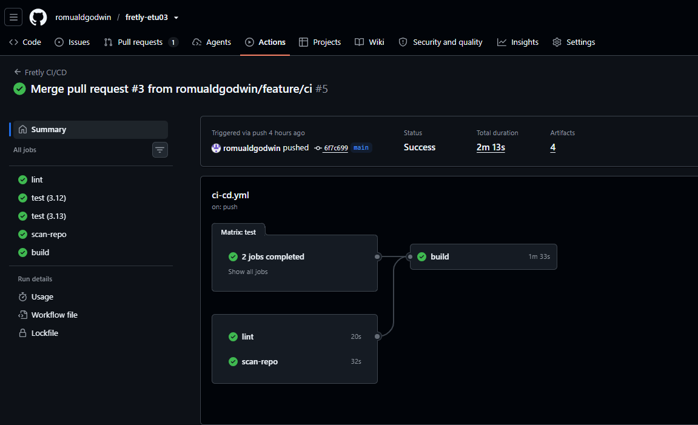
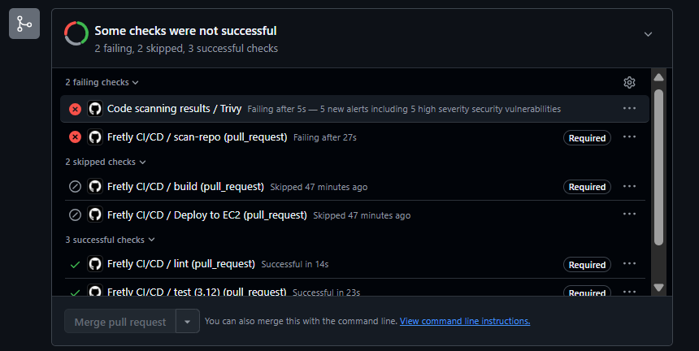

# Fretly API — Projet DevSecOps CI/CD sécurisé

API de suivi d'expéditions de la société **Fretly**, spécialisée dans le transport de colis entre professionnels.

Ce dépôt présente la mise en place d'une chaîne **CI/CD sécurisée** avec GitHub Actions, Docker, Trivy, GitHub Container Registry (GHCR) et AWS EC2, dans le cadre de l'épreuve **EC06 — CI/CD et versioning**.

> **État:** les tests, les scans Trivy, la construction Docker et la publication GHCR sont validés. Le déploiement sur EC2 est encore **à finaliser** : l'authentification SSH et le téléchargement des images fonctionnent, mais PostgreSQL est signalé `unhealthy`. Il serait incorrect de déclarer le déploiement opérationnel avant la réussite des tests `/health` et `/version`.

## 1. Stack technique

| Élément                 | Technologie                  | Utilité                                         |
| ----------------------- | ---------------------------- | ----------------------------------------------- |
| API                     | Python 3.12, FastAPI         | Exposer les services de suivi des colis         |
| Données                 | SQLAlchemy 2                 | Accès à la base de données                      |
| Base locale sans Docker | SQLite                       | Développement rapide                            |
| Base avec Docker        | PostgreSQL 16                | Persistance des expéditions                     |
| Qualité                 | pytest, pytest-cov, Ruff     | Tests, couverture et lint                       |
| Conteneurs              | Docker, Docker Compose       | Construire et exécuter les services             |
| CI/CD                   | GitHub Actions               | Automatiser les vérifications et le déploiement |
| Sécurité                | Trivy, SARIF, SBOM CycloneDX | Analyser et documenter les risques              |
| Registre                | GHCR                         | Stocker les imagesDocker                        |
| Hébergement             | AWS EC2 (Ubuntu)             | Exécuter l'application en production            |

## 2. Fonctionnalités et routes de l'API

| Méthode | Route                    | Clé API | Rôle                                            |
| ------- | ------------------------ | ------- | ----------------------------------------------- |
| `GET`   | `/`                      | Non     | Présentation du service                         |
| `GET`   | `/health`                | Non     | Vérification de l'API et de la base             |
| `GET`   | `/version`               | Non     | Version, environnement et commit Git            |
| `GET`   | `/shipments`             | Non     | Liste des expéditions                           |
| `GET`   | `/shipments/{id}`        | Non     | Détail d'une expédition et de son prix          |
| `POST`  | `/shipments`             | Oui     | Création d'une expédition                       |
| `PATCH` | `/shipments/{id}/status` | Oui     | Modification du statut                          |
| `POST`  | `/shipments/import`      | Oui     | Import CSV (exemple : `data/colis-exemple.csv`) |

Les routes d'écriture nécessitent l'en-tête HTTP `X-API-Key`. La documentation interactive FastAPI est disponible à l'adresse `/docs`.

## 3. Installation et utilisation en local

### 3.1. Sans Docker (PowerShell / Windows)

Depuis la racine du projet :

```powershell
py -3.12 -m venv .venv
.\.venv\Scripts\python.exe -m pip install -r requirements-dev.txt
$env:API_KEY = "dev-local-uniquement"
.\.venv\Scripts\python.exe -m uvicorn app.main:app --reload
```

L'application utilise SQLite par défaut dans ce mode. Ouvrir <http://localhost:8000/docs>.

### 3.2. Avec Docker Compose

Créer le fichier local `.env` à partir du modèle, puis **remplacer les valeurs d'exemple par des secrets de développement** :

```powershell
Copy-Item .env.dist .env
code .env
docker compose up --build -d --wait
```

La configuration `compose.yaml` lance l'API et PostgreSQL avec un volume Docker nommé. PostgreSQL n'expose pas son port sur la machine hôte. L'API est accessible sur <http://localhost:8003/docs>.

Vérifications :

```powershell
docker compose ps
curl.exe http://localhost:8003/health
curl.exe http://localhost:8003/version
```

Pour arrêter les services sans supprimer leurs données :

```powershell
docker compose down
```

**Ne pas utiliser `docker compose down -v` si les données PostgreSQL doivent être conservées.**

### 3.3. Tests et lint

```powershell
.\.venv\Scripts\python.exe -m pytest -q
.\.venv\Scripts\python.exe -m ruff check .
```

**Résultat observé localement : 12 tests réussis et aucune erreur Ruff.** Un avertissement de dépréciation Starlette/httpx a été affiché, sans faire échouer les tests.

## 4. Variables d'environnement et secrets

| Nom                 | Usage                                                | Où le stocker                                       |
| ------------------- | ---------------------------------------------------- | --------------------------------------------------- |
| `DATABASE_URL`      | Connexion SQLAlchemy ; SQLite par défaut sans Docker | Variables de l'application / Compose                |
| `POSTGRES_USER`     | Utilisateur PostgreSQL                               | `.env` local ou configuration du déploiement        |
| `POSTGRES_PASSWORD` | Mot de passe PostgreSQL                              | `.env` ignoré par Git ; secret GitHub en production |
| `POSTGRES_DB`       | Nom de la base PostgreSQL                            | `.env` / Compose                                    |
| `API_KEY`           | Protection des routes d'écriture                     | `.env` ignoré par Git ; secret GitHub en production |
| `APP_ENV`           | `development` ou `production`                        | Configuration de l'environnement                    |
| `APP_VERSION`       | Version fonctionnelle affichée par `/version`        | Configuration de l'environnement                    |
| `GIT_COMMIT`        | Commit de l'image affiché par `/version`             | Argument Docker transmis au build                   |
| `IMAGE_TAG`         | Image GHCR exacte à déployer                         | Fichier `.env` généré lors du déploiement           |

Le fichier `.env.dist` contient **uniquement des valeurs d'exemple**. Le fichier `.env`, les clés SSH et les mots de passe ne doivent jamais être ajoutés à Git.

Sur GitHub, l'environnement **`production`** utilise les variables `EC2_HOST`, `EC2_USER` et `APP_PORT`, ainsi que les secrets `SSH_PRIVATE_KEY`, `SSH_KNOWN_HOSTS`, `API_KEY` et `POSTGRES_PASSWORD`. Les valeurs des secrets ne sont pas documentées dans ce dépôt.

## 5. Audit de sécurité initial et remédiation

Avant le premier commit du nouveau dépôt, j'ai examiné les fichiers avec Trivy :

```bash
trivy fs --scanners vuln,secret,misconfig --severity HIGH,CRITICAL .
```

L'audit initial a mis en évidence :

- **5 vulnérabilités HIGH** liées à `python-multipart==0.0.6` ;
- **une clé privée SSH** dans `legacy/deploy_manuel.sh` ;
- **un fichier `.env` sensible**, constaté par inspection manuelle.

Les corrections ont consisté à passer à `python-multipart==0.0.30`, à exclure `.env` et `legacy/`, à créer `.env.dist`, et à **initialiser un nouveau dépôt sans reprendre l'historique Git contenant les secrets**. Un simple commit de suppression n'aurait pas effacé une clé privée des anciens commits.

Après correction, le nouveau scan Trivy n'a signalé aucune vulnérabilité HIGH/CRITICAL dans `requirements.txt`, ni mauvaise configuration HIGH/CRITICAL dans `Dockerfile`. Il s'agit d'un **résultat de scan**, pas d'une garantie d'absence totale de failles. Certaines règles de Trivy peuvent également nécessiter une mise à jour de l'outil.

**Rapports conservés :** [audit détaillé](docs/audit-initial.md), [rapport avant correction](docs/audit-avant.txt) et [rapport après correction](docs/audit-apres.txt).

Une clé privée effectivement exposée doit être considérée comme compromise : elle doit être révoquée et remplacée, même si son fichier n'est plus présent dans le dépôt.

## 6. Git, versioning et protection de `main`

Le développement est organisé autour de la branche protégée **`main`**. Les changements sont préparés sur des branches dédiées, puis intégrés par **Pull Request** avec une description du contexte et des tests. Les commits suivent la convention **Conventional Commits** (`feat:`, `fix:`, `ci:`, `docs:`, etc.).

La règle GitHub **`Protect main`**, active, impose :

- une Pull Request avant fusion, sans approbation tierce obligatoire dans le cadre de cet exercice individuel ;
- la réussite des contrôles `lint`, `test (3.12)`, `test (3.13)`, `scan-repo` et `build` ;
- l'interdiction de supprimer `main` et des _force pushes_.

Le job `Deploy to EC2` n'est pas un contrôle préalable à la fusion : il doit s'exécuter **après** un push sur `main`.

**Pull Requests de référence :**

- [PR #1 — audit](https://github.com/romualdgodwin/fretly-etu03/pull/1)
- [PR #2 — Docker](https://github.com/romualdgodwin/fretly-etu03/pull/2)
- [PR #3 — pipeline CI, sécurité et build](https://github.com/romualdgodwin/fretly-etu03/pull/3)
- [PR #4 — déploiement automatique EC2](https://github.com/romualdgodwin/fretly-etu03/pull/4)
- [PR #5 — démonstration CVE](https://github.com/romualdgodwin/fretly-etu03/pull/5), **volontairement non fusionnée**.

## 7. Docker : architecture et contraintes

Le `Dockerfile` est **multi-stage** : une première étape installe les dépendances dans un environnement virtuel, puis la seconde crée l'image d'exécution à partir de `python:3.12-alpine3.22`.

L'image finale :

- exécute l'application en tant qu'utilisateur non privilégié (`appuser`, UID `10001`) ;
- expose le port interne `8000` ;
- définit un `HEALTHCHECK` sur `/health` ;
- intègre le commit Git grâce à l'argument de build `GIT_COMMIT` ;
- exclut les fichiers sensibles ou inutiles grâce à `.dockerignore`.

Lors du test local, sa taille était d'environ **149 Mo**, sous la limite demandée de **200 Mo**. Le scan de configuration Dockerfile et le scan d'image Trivy ont été validés lors de cette vérification.

Avec `compose.yaml` ou `compose.prod.yaml`, PostgreSQL utilise un **volume nommé**, l'API attend que le contrôle de santé PostgreSQL réussisse, et les deux services sont limités à **256 Mo de mémoire et 0,5 CPU chacun**. Le port PostgreSQL n'est pas publié à l'extérieur.

## 8. Pipeline GitHub Actions

Workflow : [`.github/workflows/ci-cd.yml`](.github/workflows/ci-cd.yml).

### 8.1. Enchaînement des jobs

```text
Pull Request vers main
       |
       +--> lint (Ruff) -----------+
       +--> test (Python 3.12) ----+
       +--> test (Python 3.13) ----+--> build Docker --> scan image Trivy --> SBOM
       +--> scan-repo (Trivy) -----+                            |
                                                         Sur PR : arrêt ici

Push sur main : mêmes contrôles --> build + scan --> GHCR --> deploy EC2 --> smoke tests
```

Le job `build` dépend de `lint`, `test` et `scan-repo`. Si une de ces vérifications échoue, la construction et la publication de l'image sont bloquées.

### 8.2. Comportement selon l'événement

| Événement                                  | Lint / tests / scan dépôt | Build / scan image / SBOM | Publication GHCR            | Déploiement EC2             |
| ------------------------------------------ | ------------------------- | ------------------------- | --------------------------- | --------------------------- |
| Pull Request vers `main`                   | Oui                       | Oui si contrôles validés  | Non                         | Non                         |
| Push sur `main`                            | Oui                       | Oui si contrôles validés  | Oui après scan réussi       | Oui après publication       |
| Déclenchement manuel (`workflow_dispatch`) | Oui                       | Oui si contrôles validés  | Non dans le workflow actuel | Non dans le workflow actuel |

Les tests utilisent **Python 3.12 et 3.13**, le cache `pip`, un rapport JUnit et un rapport de couverture. Le job `scan-repo` vérifie vulnérabilités, secrets et mauvaises configurations, puis envoie un rapport **SARIF** dans GitHub Code Scanning. Le job `build` génère un **SBOM CycloneDX** téléchargeable dans les artefacts GitHub Actions.

### 8.3. Sécurité de la pipeline

Les permissions globales GitHub Actions sont limitées (`permissions: {}`), puis accordées **job par job** en fonction des besoins. L'action Trivy est référencée par un **SHA complet** plutôt que par une étiquette mutable. La concurrence annule les exécutions de PR dépassées.

Le scan de l'image est **bloquant avant son push**. Le paramètre `--ignore-unfixed` permet de ne pas bloquer sur des vulnérabilités sans correctif connu ; en contrepartie, certains risques restent présents et doivent être suivis. L'analyse automatisée ne remplace ni une revue de code ni des tests de sécurité complémentaires.

## 9. GHCR : publication et traçabilité

Après validation du job `build` sur `main`, l'image est publiée sur GitHub Container Registry :

```text
ghcr.io/romualdgodwin/fretly-etu03:sha-<7-caracteres-du-commit>
ghcr.io/romualdgodwin/fretly-etu03:latest
```

Le tag **`sha-...`** est celui à utiliser pour un déploiement traçable, car il identifie précisément le commit qui a servi à construire l'image. **`latest`** est pratique, mais change à chaque publication et peut conduire à utiliser une image différente de celle attendue.

La construction et l'analyse d'image ont réussi, et l'étape **Publish scanned image** a été validée sur `main`.

## 10. Déploiement continu sur AWS EC2

Le serveur d'exercice est accessible en SSH via l'utilisateur `etu03`, dans le dossier de travail `/home/etu03/fretly`. La configuration de production est dans [`compose.prod.yaml`](compose.prod.yaml), avec le nom de projet Docker Compose **`fretly-etu03`** et le port HTTP **`8003`**.

Le job `deploy` s'exécute uniquement après un **push sur `main`**, dépend du succès de `build` et utilise l'environnement GitHub **`production`**, réservé à la branche `main`.

Étapes automatisées :

1. Configurer l'accès SSH et vérifier la clé du serveur via `SSH_KNOWN_HOSTS` avec `StrictHostKeyChecking=yes`.
2. Créer le fichier `.env` à partir des secrets GitHub, sans l'ajouter au dépôt ; appliquer les permissions `600`.
3. Transférer `compose.prod.yaml` et `.env` dans le dossier personnel du compte EC2.
4. Se connecter à GHCR, télécharger l'image liée au commit, puis lancer Docker Compose avec `--wait`.
5. Vérifier `/health` et vérifier que `/version` expose exactement le commit déployé.

**État réellement observé :** SSH fonctionne, l'authentification GHCR réussit et les images API/PostgreSQL sont téléchargées. Le déploiement échoue ensuite avec `container fretly-etu03-db-1 is unhealthy` ; l'API n'a donc pas encore été validée sur EC2. Les journaux du conteneur PostgreSQL doivent être examinés pour corriger ce problème. Aucune réussite de déploiement n'est revendiquée à ce stade.

Après correction, les commandes de diagnostic autorisées sur EC2 seront :

```bash
cd /home/etu03/fretly
docker compose -f compose.prod.yaml ps
curl --fail http://localhost:8003/health
curl --fail http://localhost:8003/version
```

URL de documentation visée : <http://51.44.164.69:8003/docs> (**à valider après réparation du déploiement**).

## 11. Démonstration de sécurité : PR `demo/cve`

Une branche de démonstration réintroduit volontairement la dépendance **`python-multipart==0.0.6`**, sans la publier en production.

Sur la [PR #5](https://github.com/romualdgodwin/fretly-etu03/pull/5), les résultats observés sont :

- **5 alertes de sécurité HIGH** signalées par Trivy ;
- job **`scan-repo` en échec**, requis pour fusionner ;
- job **`build` ignoré**, car les conditions de sécurité ne sont pas remplies ;
- job **`deploy` ignoré** sur cette Pull Request ;
- tests Python et Ruff réussis : cela montre qu'un code fonctionnel peut tout de même présenter un risque de sécurité.

**Cette PR est volontairement laissée ouverte et ne doit jamais être fusionnée.** Elle prouve que la protection de `main` peut empêcher une dépendance vulnérable d'entrer dans le projet.

## 12. Risques, limites et améliorations envisagées

- **Clés compromises :** les révoquer/remplacer et examiner les accès ; l'exclusion de Git ne suffit pas si la clé a été exposée.
- **Droits Docker sur un EC2 partagé :** l'appartenance au groupe Docker peut donner des privilèges équivalents à `root`. Une isolation renforcée, un hôte dédié ou une exécution _rootless_ seraient préférables.
- **Gestion des secrets :** conserver les secrets dans GitHub Environments ; envisager un gestionnaire dédié et la rotation régulière.
- **Dépendances :** maintenir Python, les images de base et Trivy à jour ; surveiller les alertes sans correctif.
- **Traçabilité :** compléter la stratégie des tags SHA par une signature des images et une vérification à l'exécution.
- **Authentification cloud :** privilégier OIDC et des identités temporaires plutôt que des identifiants statiques, lorsque l'architecture le permet.
- **Qualité continue :** ajouter des tests DAST et des contrôles d'intégration en environnement de préproduction.
- **Fiabilité CD :** ajouter un mécanisme de rollback et des alertes lorsque les contrôles de santé échouent.

## 13. Preuves et captures d'écran

Les preuves sont à ajouter dans **`docs/screenshots/`**, puis à inclure dans le rendu. Les fichiers ci-dessous sont des **noms prévus** ; les captures doivent être prises et vérifiées avant soumission.

| Preuve               | Fichier prévu                               | Ce qui doit être visible                                    |
| -------------------- | ------------------------------------------- | ----------------------------------------------------------- |
| Pull Requests        | `docs/screenshots/01-pull-requests.png`     | PR fusionnées et PR CVE non fusionnée                       |
| Protection de `main` | `docs/screenshots/02-protection-main.png`   | Ruleset actif et checks obligatoires                        |
| Pipeline réussie     | `docs/screenshots/03-pipeline-success.png`  | Jobs CI et publication GHCR réussis                         |
| PR CVE bloquée       | `docs/screenshots/04-trivy-cve-blocked.png` | 5 HIGH, `scan-repo` rouge, `build` ignoré                   |
| Image GHCR           | `docs/screenshots/05-ghcr-image.png`        | Image et tags `sha-...` / `latest`                          |
| Déploiement EC2      | `docs/screenshots/06-ec2-deployment.png`    | Jobs verts et endpoints OK, **après correction uniquement** |

Liens complémentaires : [GitHub Actions](https://github.com/romualdgodwin/fretly-etu03/actions), [protection de `main`](https://github.com/romualdgodwin/fretly-etu03/rules/26047510), [PR CVE bloquée](https://github.com/romualdgodwin/fretly-etu03/pull/5).

Quand les images seront réellement présentes, elles pourront être affichées dans le README avec une syntaxe comme :

```markdown


```

## 14. Livraison et conclusion

La livraison attendue comprend le dépôt Git, ses branches et Pull Requests, les fichiers Docker/Compose, le workflow GitHub Actions, les rapports d'audit, le SBOM généré en artefact GitHub Actions, les captures d'écran et une archive ZIP du projet incluant **`.git`**, mais **excluant** `.env`, les clés privées et `.venv`.

Le projet démontre déjà une **chaîne CI sécurisée fonctionnelle** : tests, lint, audits Trivy, construction Docker, SBOM, contrôle de Pull Request et publication GHCR. Il montre également qu'une PR introduisant une dépendance vulnérable est détectée et bloquée. Le **déploiement continu complet reste en cours de correction** tant que PostgreSQL n'est pas sain sur EC2 et que les tests de fonctionnement ne réussissent pas.
